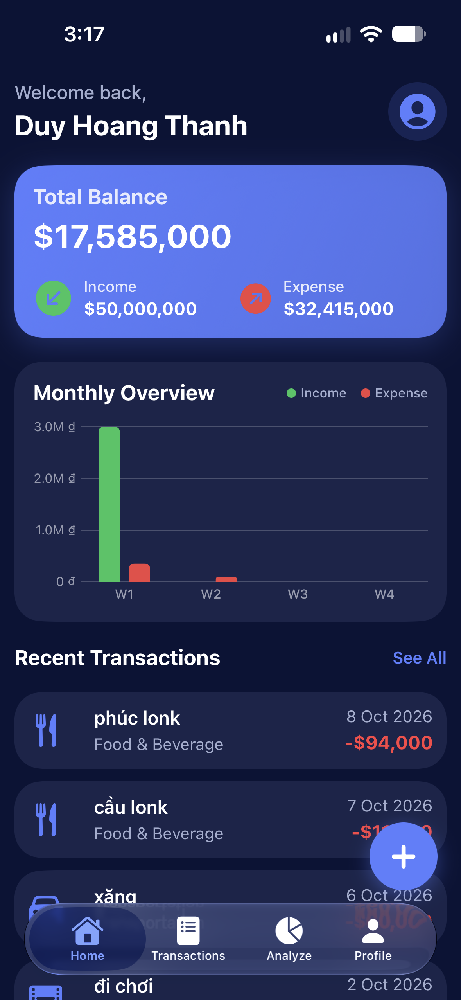
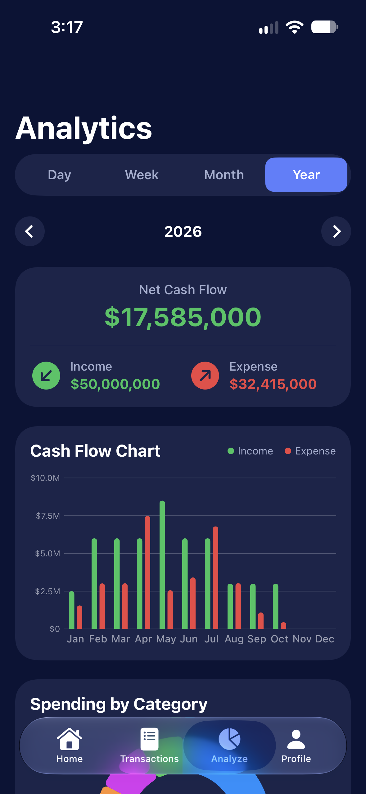
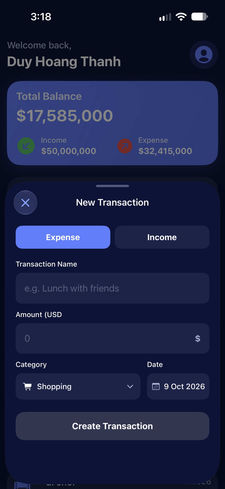
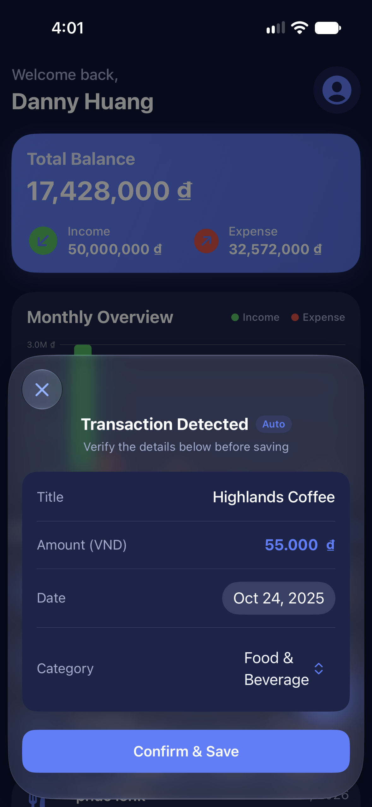
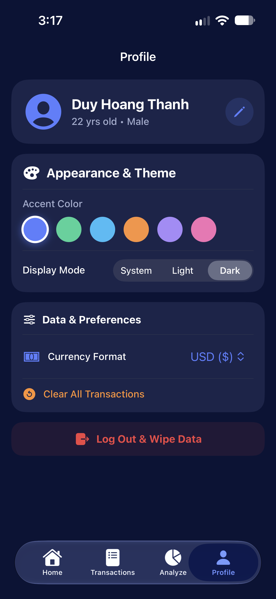

# 💸 Wally - Smart Personal Finance Tracker

<p align="center">
  
  
  
  
  
</p>

<p align="center">
  A sleek, performance-driven personal expense tracker built with pure <b>SwiftUI</b>, <b>Swift Charts</b>, and on-device <b>Apple Vision OCR</b>. Focused on instant reactive UI updates, smart receipt extraction, dynamic theming, and an uncompromising user experience.
</p>

---

## 🌟 Key Highlights

- **🧾 Smart On-Device Receipt & Slip OCR Engine**:
  - **Dual-Mode Hybrid Classifier**: Automatically distinguishes between multi-column physical paper receipts and digital banking/e-wallet transaction slips (MoMo, ZaloPay, Techcombank, Vietcombank, etc.).
  - **2D Spatial Clustering & Ray-Casting**: Reconstructs physical receipt layouts by horizontal alignment to accurately map bill labels to their corresponding prices, even across complex folded or multi-column layouts.
  - **Hero Amount & Brand Extraction**: Intelligently identifies the primary payment figure while discarding transaction IDs, phone numbers, and sub-items. Normalizes complex vendor names (e.g., _Highlands Coffee_, _Phúc Long_, _Grab_) into clean display titles.
  - **Statement Guard**: Automatically detects and gracefully rejects multi-transaction history lists/bank statements to prevent data contamination and maintain single-entry integrity.
- **⚡ Reactive App-Wide Theming Engine**: Switch between 6 curated accent palettes (`Indigo`, `Emerald`, `Ocean Blue`, `Sunset Orange`, `Purple`, `Rose Pink`) and `Light/Dark Mode` instantly across the entire navigation stack with smooth transitions.
- **💱 Dynamic Multi-Currency Formatting**: Seamlessly toggle between `VND (₫)` and `USD ($)`. All account balances, summary cards, and chart axes re-format on the fly using centralized formatting logic.
- **📊 Interactive Cash Flow & Category Analytics**:
  - Multi-scope cash flow tracking (`Day`, `Week`, `Month`, `Year`) powered by **Swift Charts**.
  - Interactive Donut chart displaying real-time expense category breakdowns with percentage allocation bars.
- **🛡️ Bulletproof UX & Input Validation**:
  - **Debounced Input Validation** (300ms) for responsive error feedback without main-thread stuttering.
  - Interactive keyboard dismissal (`.scrollDismissesKeyboard(.interactively)`) and seamless avoidance.
  - Safe **Danger Zone** with mandatory typing verification (`"LOGOUT"` / `"CLEAR"`) to prevent accidental data loss.

---

## 🏗️ Architecture & Tech Stack

- **Frameworks**: SwiftUI, Swift Charts, Vision, CoreGraphics, Combine, PhotosUI
- **Architecture**: **MVVM (Model - View - ViewModel)** with a unidirectional state flow:
  - `ReceiptOCRParser`: Core on-device parsing engine utilizing `OCRTextMatcher` and spatial geometric heuristic models to extract transactions from `VNRecognizeTextRequest` observations.
  - `ThemeManager` (`ObservableObject`): Single Source of Truth for accent palettes, appearance mode, and active currency formatting.
  - `UserManager` (`ObservableObject`): Handles session lifecycle, user profile state, and avatar synchronization across views.
  - `TransactionsViewModel` & `AnalyzeViewModel`: Encapsulates transaction CRUD, date math, periodic filtering, and chart data transformation.
- **Persistence**: `UserDefaults` with robust `Codable` wrappers.
- **Design System**: Modular, reusable component library (`AppColors`, `AuthTextField`, `AppButton`, Capsule Picker Menus).

---

## 📸 Screenshots

|                 Home Dashboard                 |                  Visual Analytics                   |                      Quick Entry Form                       |                   OCR Smart Scanner                   |                 Settings & Theme                  |
| :--------------------------------------------: | :-------------------------------------------------: | :---------------------------------------------------------: | :---------------------------------------------------: | :-----------------------------------------------: |
|  |  |  |  |  |

---

## 🚀 Getting Started

1. **Clone the repository**:

   ```bash
   git clone https://github.com/dannydev245/wally-ios-app.git
   cd wally-ios-app
   ```

2. **Requirements**:
   - Xcode 15.0+
   - iOS 17.0+ (Simulator or Physical Device)
   - Camera & Photo Library access enabled (for Document Camera & Receipt OCR scanning)

3. **Build & Run**:
   - Open `RandumApp.xcodeproj` in Xcode.
   - Select your target device / simulator and press `Cmd + R`.

---

## 👨‍💻 Author

**Duy Hoang Thanh (dannyduy)**

- GitHub: [@dannydev245](https://github.com/dannydev245)
